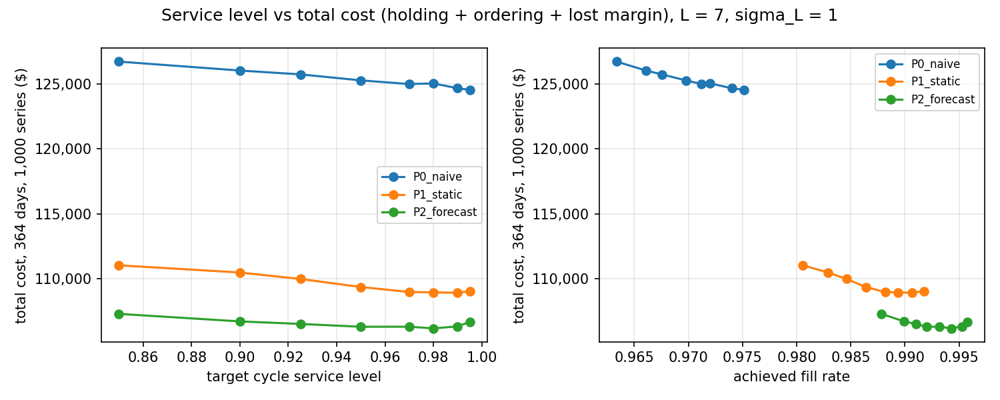
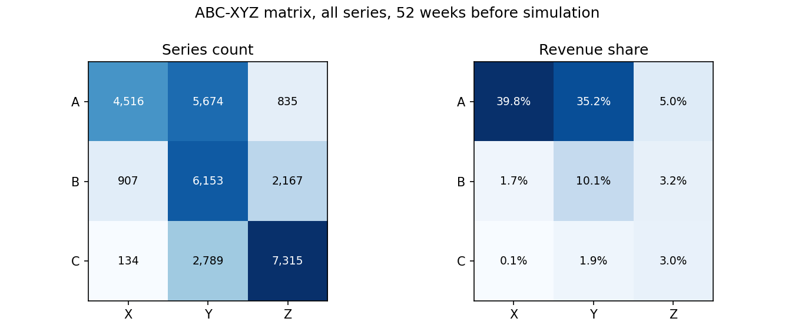
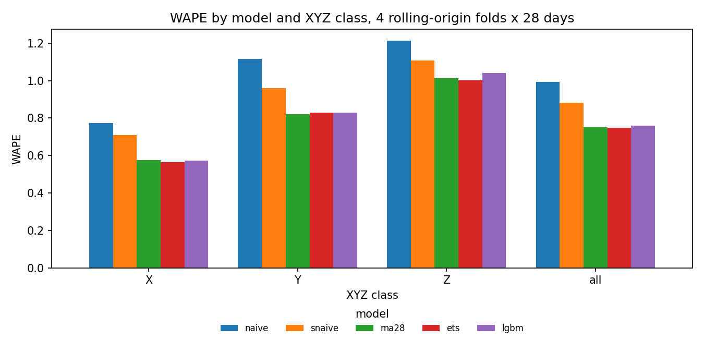

# Inventory policy simulation on Walmart M5 data

**Question:** given historical retail demand, what reorder policy reaches a 95% service level at the lowest total inventory cost, and how much does a forecast-driven policy beat a naive fixed policy?

**Result** (1,000 item-store series, 364 days simulated daily, 7-day lead time):

| Policy | Fill rate | Cycle service level | Total cost | vs naive |
|---|---:|---:|---:|---:|
| P0 naive (trailing 90 days) | 97.06% | 63.5% | $125,117 | 0.0% |
| P1 static ROP/EOQ (full history) | 98.78% | 76.1% | $108,860 | -13.0% |
| P2 forecast-driven (LightGBM, refreshed every 28 days) | 99.29% | 83.5% | $106,184 | -15.1% |

- The forecast-driven policy is 15.1% cheaper than the naive rule. Most of that (13.0 points) comes from estimating on the full history. The forecast adds 2.5% over the static policy, and its edge grows with longer lead times.
- LightGBM did not beat ETS or a 28-day moving average on forecast accuracy (WAPE 0.759 vs 0.749 and 0.751).
- No policy reaches a 95% cycle service level. The normal-approximation safety stock understates lead-time demand for intermittent series. All P1 and P2 settings exceed a 98% fill rate.

Limitation: M5 contains sales, not stock on hand. Inventory is simulated against observed sales treated as demand.



Dashboard screenshot: TBD (`powerbi/screenshots/01_executive.png`, built from `powerbi/README.md`).

Full write-up: [docs/case_study.md](docs/case_study.md). All numbers: [docs/results.md](docs/results.md) (generated).

---

## What is in the repo

| Step | Code | Output |
|---|---|---|
| Ingest 59M daily rows into DuckDB | `src/ingest.py`, `sql/00_schema.sql` | `data/warehouse.duckdb` |
| Data quality and reconciliation | `src/dq.py`, `sql/01_data_quality.sql` | [docs/dq_report.md](docs/dq_report.md) |
| ABC-XYZ segmentation (SQL, cross-checked in Python) and 1,000-series sample | `src/segment.py`, `sql/02_abc_xyz.sql` |  |
| Forecasting: naive, seasonal naive, MA, ETS, LightGBM; rolling origin | `src/forecast.py`, `src/metrics.py` |  |
| Inventory simulation: 3 policies x 17 scenarios | `src/simulate.py` | `policy_results`, `policy_summary` |
| Marts for Power BI, figures, results | `src/report.py`, `sql/03_marts.sql` | `powerbi/data/*.csv`, [docs/results.md](docs/results.md) |

Assumptions: [docs/assumptions.md](docs/assumptions.md). Judgment calls: [docs/decisions.md](docs/decisions.md). Method: [docs/methodology.md](docs/methodology.md). Dashboard build guide and DAX: [powerbi/](powerbi/).

## Run it

Requires Python 3.11, GNU make, and a Kaggle account that has accepted the [M5 Forecasting - Accuracy](https://www.kaggle.com/competitions/m5-forecasting-accuracy) rules. Token setup: [data/README.md](data/README.md).

```
make setup   # create .venv and install requirements
make all     # tests, download, load, DQ, segment, forecast, simulate, report
```

`make test` runs the unit tests. They check metrics and the simulation against hand-computed examples, and check forecasting for leakage. Every constant is in `config/assumptions.yaml`.

Measured on a 16-thread, 16 GB laptop: ingest 13.6 min, data quality 30 s, simulation 18 s. Forecasting (16 LightGBM trainings plus 4,000 ETS fits) is the longest step.

## Stack

Python 3.11 (pandas, numpy, statsmodels, LightGBM, scipy), DuckDB SQL, matplotlib, Power BI, pytest, make.
